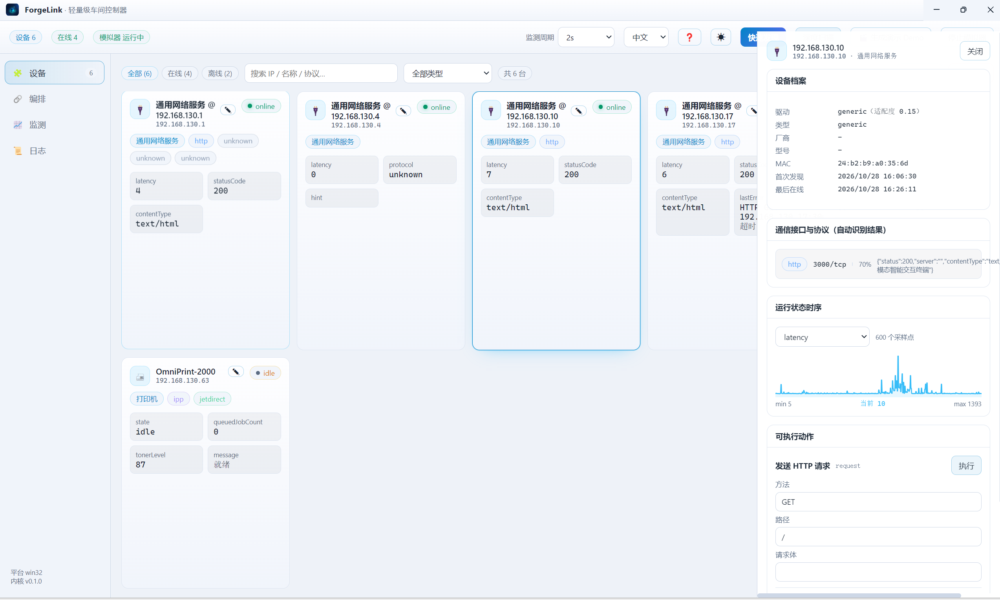
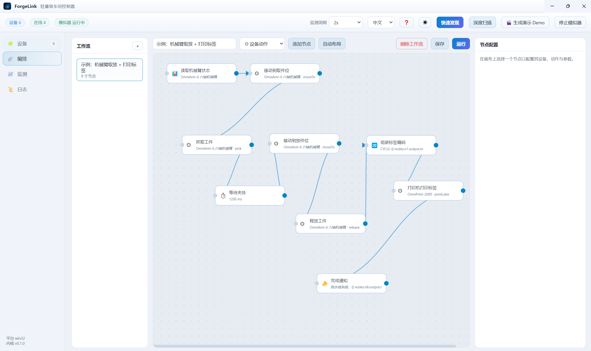
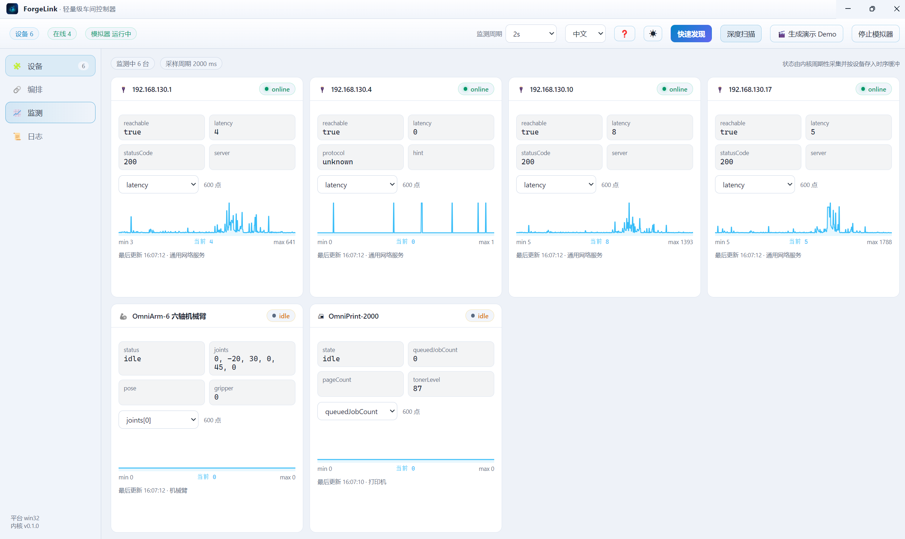
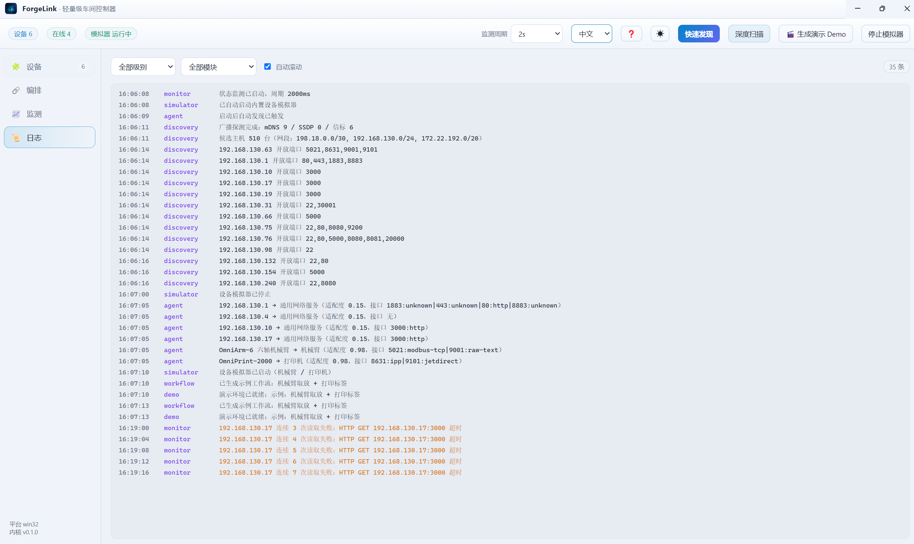

# ForgeLink · 轻量级车间控制器

<p align="center">
  <a href="README.md">English</a> · <b>简体中文</b>
</p>

> Lightweight Shopfloor Controller | Connect & Manage Robotic Arms, Factory Printers and Workshop Devices
>
> 轻量级车间控制器：连接并管理机械臂、工厂打印机与各类车间设备。

局域网设备自动发现 → 协议自动识别 → 运行状态监测 → 多设备工作流编排。
技术栈：Node.js（内核） + Vue 3（界面） + Electron（桌面端）。

## 界面预览

<table>
  <tr>
    <td align="center" width="50%">
      <br />
      <sub><b>设备发现</b>：按在线状态分组，协议与可用动作就近展示</sub>
    </td>
    <td align="center" width="50%">
      <br />
      <sub><b>工作流编排</b>：DAG 画布、自动布局与节点配置面板</sub>
    </td>
  </tr>
  <tr>
    <td align="center" width="50%">
      <br />
      <sub><b>状态监测</b>：逐设备曲线与最近一次采样</sub>
    </td>
    <td align="center" width="50%">
      <br />
      <sub><b>运行日志</b>：内核事件按类别过滤</sub>
    </td>
  </tr>
</table>

## 设计：五层递进

| 层 | 要解决的问题 | 实现 |
| --- | --- | --- |
| L1 端点发现 | 局域网里有什么 | ARP 表 + 网段推导、TCP 端口并发探测、mDNS/DNS-SD、SSDP/UPnP、UDP 信标 |
| L2 协议识别 | 它说什么语言 | 对每个开放端口按「先验 + 实际响应」打分：Modbus-TCP / IPP / SNMP / HTTP / WebSocket / Raw-Text |
| L3 能力归一 | 怎么统一控制 | `DeviceDriver` 抽象出 `readState` / `invoke` / `subscribe` 三个原语 |
| L4 任务编排 | 多设备如何协同 | DAG 引擎，节点 = 一次能力调用，边 = 数据流转（`{{ nodes.x.output.y }}`） |
| L5 可观测 | 人怎么看 | 周期采集写入时序缓冲，桌面端实时曲线 + 事件日志 |

上层只依赖下层抽象：**新增一种设备 = 新增一个 Driver**，不动发现、编排与界面。

## 快速开始

```bash
npm install
npm run build     # 构建前端产物 dist-renderer
npm start         # 启动桌面端（内置机械臂/打印机模拟器会自动拉起并自动发现）

npm run dev       # 开发模式：Vite 热更新 + Electron
npm run sim       # 只启动模拟器（不开界面，便于联调协议）
npm test          # 内核端到端测试（协议 / 发现 / 驱动 / 编排）
```

首次启动会自动：启动模拟器 → 快速发现 → 生成示例工作流「机械臂取放 + 打印标签」。

## 内置模拟器（无需真实硬件）

| 设备 | 协议与端口 |
| --- | --- |
| OmniArm-6 机械臂 | Modbus-TCP `5021`、行式文本 `9001` |
| OmniPrint-2000 打印机 | IPP `8631`、JetDirect `9101`、SNMP `8161` |

两者都通过 UDP 信标（`47809`）与 mDNS 自述，因此可被智能体自动发现与归类。

## 可识别的机械臂品牌

发现层用**可公开核对**的线索识别品牌：设备自述（mDNS / SNMP / HTTP / SSDP）、名称关键字、厂商公开端口。

| 厂商 | 识别线索 |
| --- | --- |
| Universal Robots（优傲） | 名称关键字（UR3/UR5/UR10/UR16/UR20）、端口 `29999`、`30001`–`30004` |
| JAKA（节卡） | 名称关键字、端口 `10000` |
| AUBO（遨博） | 名称关键字 |
| Rokae（珞石） | 名称关键字 |
| Han's Robot（大族） | 名称关键字 |
| Elite Robots（艾利特） | 名称关键字 |
| ESTUN（埃斯顿） | 名称关键字 |
| Peitian（配天） | 名称关键字 |
| DOBOT（越疆） | 名称关键字 |
| KUKA | 名称关键字、端口 `54600` |
| ABB | 名称关键字（ABB Robotics / RobotWare / IRB） |
| FANUC | 名称关键字（含「发那科」「法兰克」） |
| Yaskawa（安川） | 名称关键字（含 Motoman） |
| Mitsubishi MELFA（三菱） | 名称关键字、端口 `10000` |

驱动层不按品牌分叉：只要机械臂走 Modbus-TCP，就能用同一个 `RobotArmDriver` 接入。各厂商的寄存器映射是私有约定、没有公开标准，所以内置的是一份**默认映射模板**，接真机时在设备配置里用 `config.registerMap` 覆盖即可（见 `src/main/drivers/robot-arm.js`）。动作集（回零 / 关节移动 / 直线移动 / 抓取 / 释放 / 速度 / IO / 复位 / 清报警 / 急停）与品牌无关，换品牌只改映射、不改工作流。

## 目录

```
src/main/
  kernel/     事件总线、JSON 持久化、设备注册表（接口聚合成设备 + 时序缓冲）
  discovery/  ARP、端口扫描、mDNS、SSDP、信标、端口指纹、发现编排器
  protocols/  TCP 会话、Modbus-TCP、IPP、SNMP、HTTP、WebSocket、行式文本、协议识别
  drivers/    驱动抽象、机械臂、打印机、通用兜底、驱动选型
  runtime/    智能体、状态监测、工作流引擎（DAG + 表达式）
  simulator/  机械臂与打印机模拟器、mDNS 应答器、信标应答
src/renderer/ Vue 3 界面：设备 / 编排 / 监测 / 日志
```

## 新增一种设备

1. 在 `src/main/drivers/` 新建驱动，继承 `DeviceDriver`，实现 `readState` / `invoke`，
   声明 `protocols` / `actions` / `stateFields`，并实现 `static fitness(facts)` 给出适配度；
2. 在 `src/main/drivers/index.js` 的 `DRIVERS` 中注册。

若需要新协议，在 `src/main/protocols/` 增加实现并在 `detect.js` 注册探针即可。

## 已验证

- Modbus-TCP / IPP / SNMP / 行式文本 四种协议读写
- 自动发现并正确归类机械臂（modbus-tcp + raw-text）与打印机（ipp + jetdirect）
- 下发动作后状态真实变化（关节角位移、打印作业计数）
- 多设备 DAG 工作流跨设备数据流转成功
