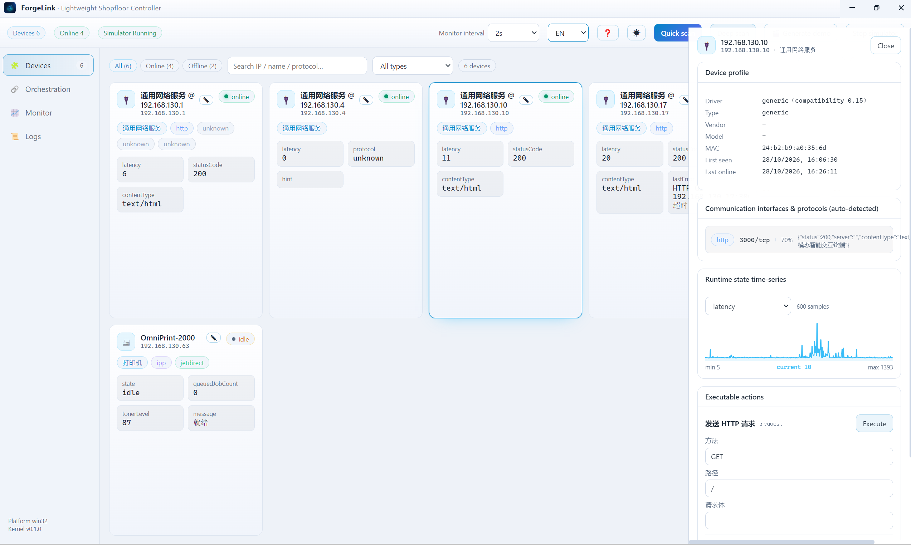
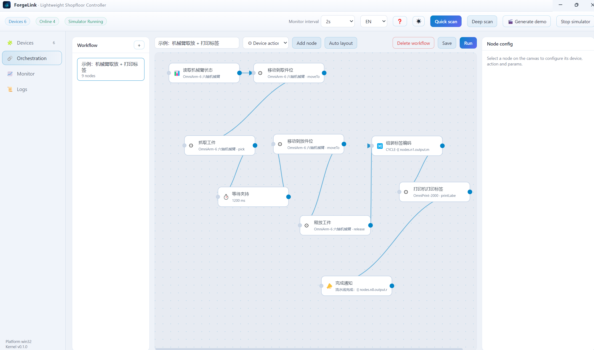
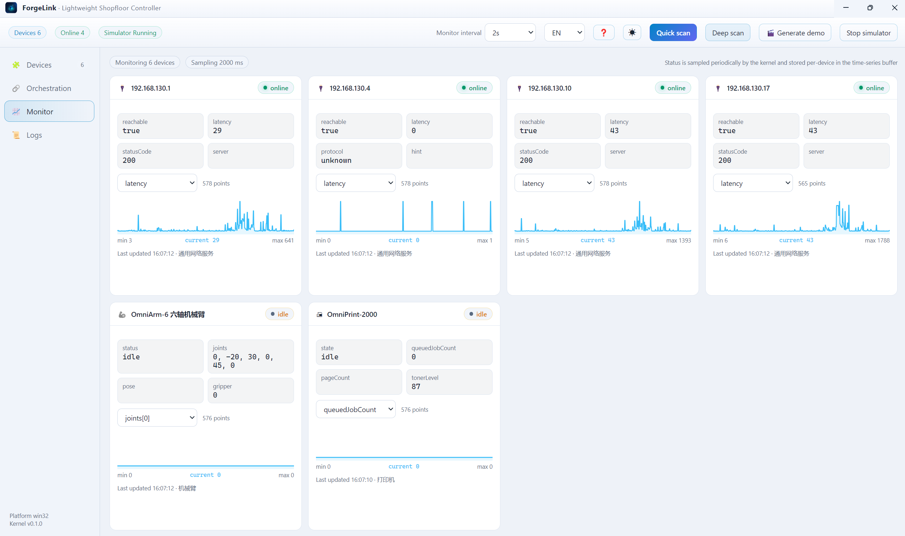
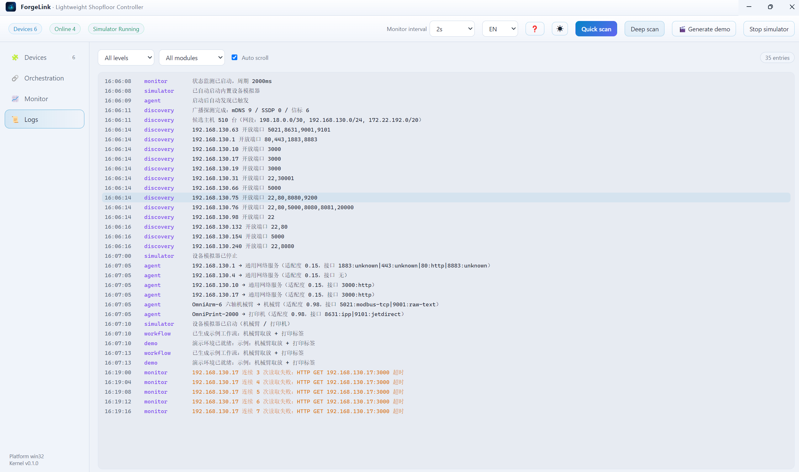

# ForgeLink · Lightweight Shopfloor Controller

<p align="center">
  <b>English</b> · <a href="README-zh.md">简体中文</a>
</p>

> Connect & Manage Robotic Arms, Factory Printers and Workshop Devices

Auto-discover LAN devices → auto-identify protocols → monitor runtime status → orchestrate multi-device workflows.
Tech stack: Node.js (kernel) + Vue 3 (UI) + Electron (desktop).

## Screenshots

<table>
  <tr>
    <td align="center" width="50%">
      <br />
      <sub><b>Devices</b>: grouped by status, protocols and actions shown inline</sub>
    </td>
    <td align="center" width="50%">
      <br />
      <sub><b>Orchestration</b>: DAG canvas, auto-layout and node inspector</sub>
    </td>
  </tr>
  <tr>
    <td align="center" width="50%">
      <br />
      <sub><b>Monitor</b>: per-device curves with the latest sample</sub>
    </td>
    <td align="center" width="50%">
      <br />
      <sub><b>Logs</b>: kernel events filtered by category</sub>
    </td>
  </tr>
</table>

## Design: Five Progressive Layers

| Layer | Problem solved | Implementation |
| --- | --- | --- |
| L1 Endpoint Discovery | What's on the LAN | ARP table + subnet inference, concurrent TCP port probing, mDNS/DNS-SD, SSDP/UPnP, UDP beacon |
| L2 Protocol Identification | What language it speaks | Score each open port by "prior + actual response": Modbus-TCP / IPP / SNMP / HTTP / WebSocket / Raw-Text |
| L3 Capability Unification | How to control uniformly | `DeviceDriver` abstracts three primitives: `readState` / `invoke` / `subscribe` |
| L4 Task Orchestration | How devices coordinate | DAG engine, node = one capability call, edge = data flow (`{{ nodes.x.output.y }}`) |
| L5 Observability | How humans see it | Periodic sampling written to a time-series buffer, real-time curves + event logs on the desktop |

Upper layers depend only on lower-layer abstractions: **adding a new device = adding a new Driver**, without touching discovery, orchestration, or the UI.

## Quick Start

```bash
npm install
npm run build     # build frontend assets (dist-renderer)
npm start         # launch desktop app (built-in robot-arm/printer simulators auto-start and auto-discover)

npm run dev       # dev mode: Vite hot-reload + Electron
npm run sim       # launch simulators only (no UI, handy for protocol debugging)
npm test          # kernel end-to-end tests (protocol / discovery / driver / orchestration)
```

On first launch it automatically: starts simulators → quick discovery → generates a sample workflow "robot-arm pick & place + print label".

## Built-in Simulators (no real hardware required)

| Device | Protocol & Port |
| --- | --- |
| OmniArm-6 robot arm | Modbus-TCP `5021`, raw text `9001` |
| OmniPrint-2000 printer | IPP `8631`, JetDirect `9101`, SNMP `8161` |

Both self-announce via a UDP beacon (`47809`) and mDNS, so they are auto-discovered and classified by the agent.

## Identifiable Robot Arm Brands

Brand is identified during discovery from **publicly verifiable** clues only: device self-description (mDNS / SNMP / HTTP / SSDP), name keywords, and vendor-published ports.

| Vendor | Clues |
| --- | --- |
| Universal Robots | name keywords (UR3/UR5/UR10/UR16/UR20), ports `29999`, `30001`–`30004` |
| JAKA | name keywords, port `10000` |
| AUBO | name keywords |
| Rokae | name keywords |
| Han's Robot | name keywords |
| Elite Robots | name keywords |
| ESTUN | name keywords |
| Peitian | name keywords |
| DOBOT | name keywords |
| KUKA | name keywords, port `54600` |
| ABB | name keywords (ABB Robotics / RobotWare / IRB) |
| FANUC | name keywords |
| Yaskawa | name keywords (incl. Motoman) |
| Mitsubishi MELFA | name keywords, port `10000` |

The driver layer does not branch per brand: any arm speaking Modbus-TCP can be attached through the same `RobotArmDriver`. Register maps are private vendor conventions with no public standard, so the built-in one is only a **default template** — override it per device via `config.registerMap` (see `src/main/drivers/robot-arm.js`). The action set (home / joint move / linear move / grip / release / speed / IO / reset / clear alarm / e-stop) is brand-agnostic: switching brands changes the map, not the workflow.

## Directory

```
src/main/
  kernel/      event bus, JSON persistence, device registry (interfaces aggregated into devices + time-series buffer)
  discovery/  ARP, port scan, mDNS, SSDP, beacon, port fingerprints, discovery orchestrator
  protocols/  TCP session, Modbus-TCP, IPP, SNMP, HTTP, WebSocket, raw text, protocol identification
  drivers/    driver abstraction, robot arm, printer, generic fallback, driver selection
  runtime/    agent, status monitor, workflow engine (DAG + expressions)
  simulator/  robot-arm & printer simulators, mDNS responder, beacon responder
src/renderer/ Vue 3 UI: devices / orchestration / monitoring / logs
```

## Add a New Device

1. Create a driver under `src/main/drivers/`, extend `DeviceDriver`, implement `readState` / `invoke`,
   declare `protocols` / `actions` / `stateFields`, and implement `static fitness(facts)` to report compatibility;
2. Register it in `DRIVERS` inside `src/main/drivers/index.js`.

If a new protocol is needed, add an implementation under `src/main/protocols/` and register a probe in `detect.js`.

## Verified

- Read/write for four protocols: Modbus-TCP / IPP / SNMP / raw text
- Auto-discovery and correct classification of the robot arm (modbus-tcp + raw-text) and printer (ipp + jetdirect)
- State actually changes after actions are issued (joint-angle displacement, print-job count)
- Multi-device DAG workflow with cross-device data flow succeeds
